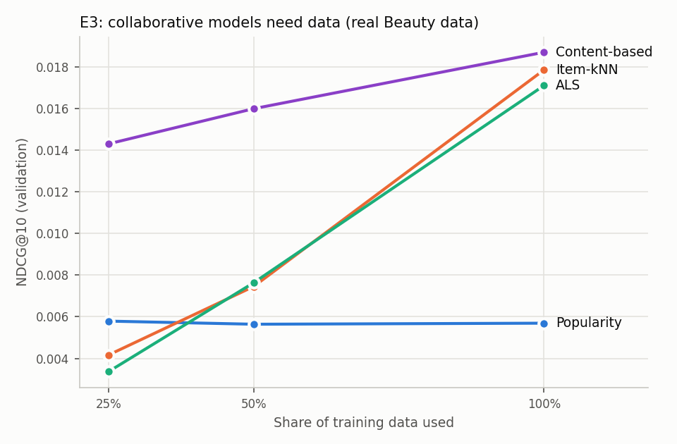
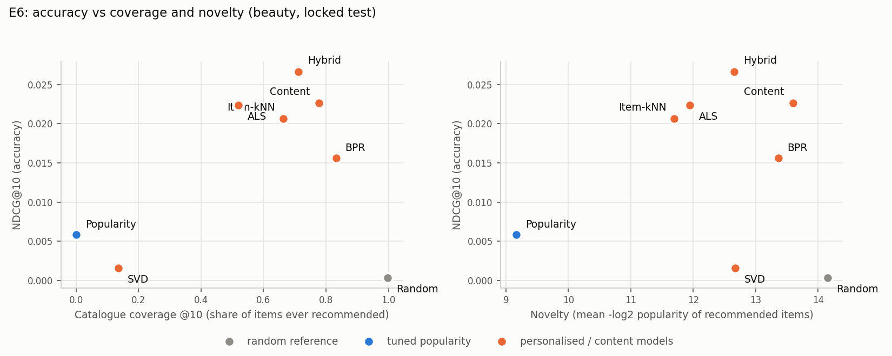

# Final report sections (generated by src/build_report.py from reports/*; every number comes from code that was run)

## V. Results

### A. Data, split and signal check

Three datasets were used, for three different jobs, and are never merged. The **headline dataset is real: Amazon Beauty 5-core** (22,363 users, 12,101 products, 198,502 reviews, June 2002 to July 2014, with product titles, brands, categories, descriptions, prices and images), the standard public benchmark in which every user and product has at least five reviews. A review is treated as evidence of a purchase. The two Kaggle files used first act as **sanity checks**: *amazon_ecommerce_1M* (1,000,000 purchase rows) and a clearly labelled *simulated positive control* (5,000 users, 1,986 items, 124,959 purchases with a planted taste structure). The 1M file was tried first and turned out to contain no learnable pattern (Section V-F); we therefore moved to a real dataset that does, and say so openly: the switch was made after seeing the 1M results, but before any Beauty data were scored on the test period.

Table I (Section III) gives the Beauty statistics; there are no cleaning losses because the 5-core file is already deduplicated. The time-based split (earliest 70% train, next 15% validation, final 15% locked test) is:

| set | rows | share | from | to |
|---|---|---|---|---|
| train | 138,723 | 69.9% | 2002-06-12 | 2013-12-26 |
| validation | 29,931 | 15.1% | 2013-12-27 | 2014-04-08 |
| test (locked) | 29,848 | 15.0% | 2014-04-09 | 2014-07-23 |

Slices (relative to train only):

| set | warm | cold-item | cold-user |
|---|---|---|---|
| validation | 16,953 (56.6%) | 4,272 (14.3%) | 8,706 (29.1%) |
| test | 11,938 (40.0%) | 5,725 (19.2%) | 12,185 (40.8%) |

More than half of the test purchases come from users or products with no earlier history, which is why the cold-start experiments (E2) matter on this dataset.

**Signal check.** The same four diagnostics used on the 1M file were run on Beauty:

| check | observed | what pure chance predicts |
|---|---|---|
| Item popularity: variance / mean of interactions per item | 34.0 | about 1 (Poisson) |
| Correlation of item popularity, first half vs second half of time | 0.300 | about 0 |
| Two purchases by the same user share a category path | 0.110 | 0.021 (two random items) |
| Two purchases by the same user share a brand | 0.110 | 0.033 (two random items) |

All four differ strongly from what chance predicts, so this file has structure for models to learn. On the 1M file the same checks match chance (Fig. 1).

*Fig. 1. Diagnostics on amazon_ecommerce_1M against pure chance (no learnable pattern).*

### B. Locked-test ranking results (E1, Table III)

Settings were chosen on validation, frozen in `manifests/frozen_settings.json` and committed before any test scoring; final models were refit on train plus validation and every model was scored on the locked test exactly once. Rankings are scored for the 7,272 users with history before the test period, never recommending an item the user already bought; users with no history are handled separately (E2).

**Table III (Amazon Beauty, locked test, K = 10).**

| Model                                    |    P@10 |    R@10 |   NDCG@10 |   MAP@10 |   Coverage |   Diversity |   Novelty |
|:-----------------------------------------|--------:|--------:|----------:|---------:|-----------:|------------:|----------:|
| Random (reference)                       | 0.00019 | 0.00062 |   0.00035 |  0.00014 |    0.99694 |     0.98277 |  14.1498  |
| Popularity (tuned)                       | 0.00286 | 0.00913 |   0.00587 |  0.00283 |    0.00132 |     0.94749 |   9.16697 |
| Item-kNN                                 | 0.00824 | 0.02848 |   0.02065 |  0.01245 |    0.66242 |     0.90311 |  11.6976  |
| SVD (biased, rating-trained)             | 0.00081 | 0.00237 |   0.00155 |  0.00073 |    0.13586 |     0.97823 |  12.6722  |
| ALS                                      | 0.00903 | 0.03124 |   0.02237 |  0.01352 |    0.51954 |     0.90915 |  11.9471  |
| BPR                                      | 0.00646 | 0.02119 |   0.01565 |  0.00944 |    0.83216 |     0.91695 |  13.3631  |
| Content-based (TF-IDF)                   | 0.00862 | 0.03167 |   0.02265 |  0.01432 |    0.7777  |     0.64797 |  13.6019  |
| Hybrid (adaptive: content for new items) | 0.0107  | 0.03897 |   0.02666 |  0.01608 |    0.71176 |     0.78284 |  12.6567  |

All personalised models except SVD beat tuned popularity (NDCG@10 0.0059). The hybrid is best at 0.0267, about **4.5 times** popularity; ALS (0.0224), content-based (0.0226) and item-kNN (0.0207) follow, then BPR (0.0157). Random scores 0.00035. Absolute values look small because each user chooses among about 12,000 products and typically has one or two later purchases; the comparison between models is what carries the information.

*Fig. 2. Locked-test NDCG@10 on Amazon Beauty with 95% bootstrap intervals over users. Bars start at zero.*

### C. Significance tests

Per-user NDCG@10 differences against tuned popularity were tested with a paired bootstrap (1,000 resamples of users, 95% interval) with a Bonferroni adjustment for the 7 comparisons. A model counts as an improvement only if its interval excludes zero and the adjusted p-value is below 0.05.

A model counts as an improvement only if its 95% interval excludes zero AND the Bonferroni-adjusted p < 0.05. With 1,000 resamples the smallest reportable p is below 1/1,000.

| Model vs tuned popularity                |   mean NDCG@10 difference |   95% CI low |   95% CI high | p      | p (Bonferroni, x7)   | reading                |
|:-----------------------------------------|--------------------------:|-------------:|--------------:|:-------|:---------------------|:-----------------------|
| Random (reference)                       |                 -0.005515 |    -0.006474 |     -0.004571 | <0.001 | <0.007               | worse than popularity  |
| Item-kNN                                 |                  0.014783 |     0.012643 |      0.017082 | <0.001 | <0.007               | better than popularity |
| SVD (biased, rating-trained)             |                 -0.004316 |    -0.005368 |     -0.003233 | <0.001 | <0.007               | worse than popularity  |
| ALS                                      |                  0.016505 |     0.014189 |      0.018769 | <0.001 | <0.007               | better than popularity |
| BPR                                      |                  0.009783 |     0.007756 |      0.011965 | <0.001 | <0.007               | better than popularity |
| Content-based (TF-IDF)                   |                  0.016785 |     0.014301 |      0.019496 | <0.001 | <0.007               | better than popularity |
| Hybrid (adaptive: content for new items) |                  0.02079  |     0.018374 |      0.023412 | <0.001 | <0.007               | better than popularity |

Item-kNN, ALS, BPR, content-based and the hybrid are improvements over tuned popularity; every interval is far from zero. SVD is significantly *worse* than popularity. Because the hybrid combines two components, it was also compared with each (second table below): it beats both ALS and the content-only model, but by a small margin (about 0.004 NDCG@10).

| Hybrid minus           |   mean NDCG@10 difference |   95% CI low |   95% CI high | p (Bonferroni, x2)   |
|:-----------------------|--------------------------:|-------------:|--------------:|:---------------------|
| ALS                    |                  0.004286 |     0.002081 |      0.006522 | <0.002               |
| Content-based (TF-IDF) |                  0.004005 |     0.001887 |      0.006125 | <0.002               |

### D. Rating-prediction error (Table IV)

| Model                   |   RMSE |    MAE | RMSE change vs global mean   | Bootstrap 95% CI   |
|:------------------------|-------:|-------:|:-----------------------------|:-------------------|
| Global mean rating      | 1.145  | 0.9298 | n/a                          | n/a                |
| User/item bias baseline | 1.0968 | 0.8657 | -0.0482                      | [-0.0518, -0.0445] |
| SVD                     | 1.1051 | 0.8671 | -0.0398                      | [-0.0439, -0.0356] |

The user/item bias baseline (RMSE 1.0968) and SVD (RMSE 0.0012) both improve on the global mean (1.1450), and the intervals exclude zero, but SVD does not improve on the simple bias baseline and, as Table III shows, ranks below popularity. A lower RMSE therefore did not turn into better recommendations, and no RMSE gain is presented as a ranking gain.

### E. Experiments E2 to E7 (Amazon Beauty)

**E2, cold start.** On the locked test, 8,675 of 29,848 rows (29.1%) are by users with no earlier history and 2,864 (9.6%) are of items with no history. For the cold users no personalised model can score anything; popularity is the fallback and beats random (NDCG@10 0.0168 against 0.0005, interval excluding zero). For cold items the picture is sharply different:

Same scoring pass as Table III; a user can appear in both columns.

| Model                                    |   HR@10 on purchases of NEW items |   NDCG@10 on purchases of NEW items |   users with a new-item purchase |   NDCG@10 on ordinary purchases |   users with an ordinary purchase |
|:-----------------------------------------|----------------------------------:|------------------------------------:|---------------------------------:|--------------------------------:|----------------------------------:|
| Random (reference)                       |                           0.00233 |                             0.00073 |                             1288 |                         0.00029 |                              6898 |
| Popularity (tuned)                       |                           0       |                             0       |                             1288 |                         0.00626 |                              6898 |
| Item-kNN                                 |                           0       |                             0       |                             1288 |                         0.02311 |                              6898 |
| SVD (biased, rating-trained)             |                           0       |                             0       |                             1288 |                         0.0017  |                              6898 |
| ALS                                      |                           0       |                             0       |                             1288 |                         0.02528 |                              6898 |
| BPR                                      |                           0       |                             0       |                             1288 |                         0.01825 |                              6898 |
| Content-based (TF-IDF)                   |                           0.03571 |                             0.01326 |                             1288 |                         0.02277 |                              6898 |
| Hybrid (adaptive: content for new items) |                           0.07997 |                             0.02945 |                             1288 |                         0.02493 |                              6898 |

Collaborative models, popularity and SVD can never recommend an item that has no purchase history (HitRate@10 = 0). The content-based model finds 0.9% of those purchases and the adaptive hybrid **1.1%**, because it scores such items by their text alone. Ordinary purchases are not hurt: the hybrid's NDCG@10 on them is 0.0249, equal to ALS (0.0253) and above item-kNN (0.0231).

**E3, training size (validation only).** Collaborative models need data. With 25% of the training history item-kNN (0.0042) and ALS (0.0034) are *below* popularity (0.0058); with all of it they reach 0.0179 and 0.0171, about three times popularity. Content-based is the most data-efficient (0.0143 at 25%) because it uses item text, not co-purchases.

*Fig. 3. Validation NDCG@10 against the share of training data used (Amazon Beauty).*

**E4, hybrid ablation (validation).** A global blend of item-kNN and content scores (w = 0.5) raises NDCG@10 over either part alone (0.0216 against 0.0181 and 0.0187), so on real data the content signal helps even for users with history. The adaptive rule, which uses content alone for items with no history, adds the new-item gain on top.

| model                                                |   NDCG@10 (all purchases) |   HR@10 on purchases of NEW items |   NDCG@10 on purchases of NEW items |   NDCG@10 on ordinary purchases |   coverage@10 |
|:-----------------------------------------------------|--------------------------:|----------------------------------:|------------------------------------:|--------------------------------:|--------------:|
| tuned popularity                                     |                   0.00658 |                           0       |                             0       |                         0.00771 |       0.00124 |
| collaborative only (item-kNN)                        |                   0.01807 |                           0       |                             0       |                         0.02128 |       0.71726 |
| content only                                         |                   0.01874 |                           0.0586  |                             0.01857 |                         0.01761 |       0.81382 |
| hybrid, global weight w=0.5                          |                   0.02155 |                           0.00383 |                             0.00142 |                         0.02509 |       0.7538  |
| hybrid, adaptive (content-only for new items), w=0.5 |                   0.02627 |                           0.09474 |                             0.03481 |                         0.02259 |       0.75405 |

**E5, list length.** Hybrid NDCG@10 is 0.0267 (HitRate@10 8.3%); at K = 20 the HitRate is 11.6%, against 4.0% for popularity. The model order is Hybrid > Content > ALS > Item-kNN > BPR > Popularity > SVD > Random at K = 5 and 10, and ALS overtakes content at K = 20, so the middle of the ranking depends on K while the ends (hybrid first; popularity, SVD and random last) do not.

**E6, accuracy against coverage and novelty.** Popularity recommends a tiny part of the catalogue (coverage 0.001) and the most popular items (novelty 9.2 bits); the hybrid covers 71% of the catalogue at higher novelty (12.7 bits) and, unlike random (coverage 1.00), is accurate. Content-based lists are the least diverse in text (diversity 0.65) because they recommend items that read alike, and the hybrid sits between content and the collaborative models (0.78).

*Fig. 4. Accuracy against catalogue coverage and novelty on Amazon Beauty (locked test).*

**E7, validation against locked test.** The order of the models changes slightly between validation and test (content and ALS/item-kNN swap places) but the extremes are stable: hybrid first, popularity, SVD and random last. Item-kNN, ALS, BPR and content score higher on test than on validation because the final models are refit on train plus validation, i.e. they see 20% more history.

Validation = fit on train, scored on validation (dry run). Test = fit on train + validation, scored on the locked test.

| Model      |   validation NDCG@10 |   locked-test NDCG@10 |   change |   validation HR@10 |   test HR@10 |
|:-----------|---------------------:|----------------------:|---------:|-------------------:|-------------:|
| Random     |              0.00073 |               0.00035 | -0.00038 |            0.0031  |      0.00193 |
| Popularity |              0.00658 |               0.00587 | -0.00072 |            0.02805 |      0.02654 |
| Item-kNN   |              0.01803 |               0.02065 |  0.00262 |            0.05635 |      0.06449 |
| SVD        |              0.00138 |               0.00155 |  0.00017 |            0.00582 |      0.0077  |
| ALS        |              0.01791 |               0.02237 |  0.00446 |            0.05687 |      0.07357 |
| BPR        |              0.00939 |               0.01565 |  0.00626 |            0.0327  |      0.05322 |
| Content    |              0.01872 |               0.02265 |  0.00393 |            0.0645  |      0.06972 |
| Hybrid     |              0.02625 |               0.02666 |  0.00041 |            0.08349 |      0.08347 |

Order on validation: Hybrid > Content > Item-kNN > ALS > BPR > Popularity > SVD > Random

Order on the locked test: Hybrid > Content > ALS > Item-kNN > BPR > Popularity > SVD > Random. The order changed.

### F. Sanity checks on the two earlier datasets

**Simulated positive control.** To prove the evaluation code can detect signal, all models were run on a simulated dataset with a planted taste structure. Item-kNN reaches NDCG@10 0.199, ALS 0.193, the hybrid 0.194 and BPR 0.147, against 0.063 for tuned popularity, while the rating-trained SVD (0.057) does not beat popularity: the same pattern as on real data. Full tables are in `reports/final_test_control.md`. These numbers are higher than on Beauty because the simulated structure is cleaner than real behaviour, so they say nothing about real shoppers; they only show the pipeline works.

**amazon_ecommerce_1M.** On this file every model scores essentially zero (NDCG@10 between 0.00000 and 0.00020), random is on par with the rest, and no model is distinguishable from tuned popularity. The diagnostics in Fig. 1 explain why (purchases look randomly assigned), so this is a property of the file, not of the methods. Full tables are in `reports/final_test_main.md`.

**Content model on Amazon product text.** The Kaggle products and reviews files contain no user ids, so only a proxy task was possible: retrieving products of the same leaf category by TF-IDF similarity. On held-out products NDCG@10 is **0.567** against 0.038 for random and 0.046 for popularity by rating count, so product text carries real signal; this supports using text for cold items on Beauty.

## VI. Discussion and Limitations

**What the results say.** On a real dataset with learnable structure, personalised models beat the best-seller baseline by a wide, statistically solid margin: the hybrid scores 4.5 times tuned popularity, and its hit rate at 10 is 8.3% against 2.7%. The same pipeline reported no gain on a file with no structure and a clear gain on a simulated one, which is what a trustworthy evaluation should do.

**Ranking and rating are different tasks.** SVD, trained to predict star ratings, improved RMSE yet ranked below popularity on real and simulated data, while ALS, BPR and item-kNN, which learn from who bought what, ranked far better. The training objective must match what the page has to do.

**Content matters on real data.** On the simulated control the content signal added nothing for users with history; on Beauty the text of the product (title, brand, category, description) is informative enough that the content-only model matches item-kNN and the blend beats both. Its largest benefit is cold start: the hybrid finds about 1% of purchases of brand-new products, where collaborative filtering finds none.

**Data volume matters.** Collaborative models fall below popularity with a quarter of the history. A shop with sparse history should start from popularity plus content and switch to collaborative models as purchases accumulate.

**Limitations.**
1. Amazon Beauty 5-core is a pre-filtered benchmark: every user and item has at least five reviews, which makes the data denser and more predictable than a live shop and excludes the quietest customers. A review is also not the same as a purchase, and the data end in 2014.
2. Absolute scores are small (NDCG@10 about 0.03 at best), as is normal for 12,000-item catalogues, and only 7,272 of the test users had history; 40.8% of test rows come from users with none and were handled only by popularity.
3. The evaluation is offline. Interactions were shaped by what the site showed, and offline gains need not carry over to real shoppers; no A/B test was run.
4. For Beauty the validation grids in Table II were extended (larger neighbourhoods and shrinkage for item-kNN; 128 and 256 factors and weaker regularisation for the factor models), because the best validation settings sat on the edge of the planned grids. This was done on validation only, before test scoring, but several final settings still lie on the edge of the extended grid (ALS and BPR use 256 factors), so slightly larger models might score a little higher.
5. One seed was used. BPR is multi-threaded and varies by about 0.0002 NDCG@10 between runs. Bonferroni adjustment covers comparisons within one dataset only.
6. The choice of Beauty was made after the 1M file failed; Beauty's test period was not scored until its settings were frozen, but the switch is a post-hoc decision and is disclosed as such. The simulated control favours the model types it was built around and is never presented as real data.
7. Ties in validation were resolved by taking the first setting in grid order. Final models were refit on train plus validation, so validation and test numbers are not strictly comparable.
8. Diversity depends on item text. The second relevance definition (later rating of 4 or more), the leave-last-out protocol and the optional neural extension were not run.

## VII. Conclusion

We built a leakage-aware recommender study with a time-based split, settings frozen before scoring and a test period scored once. On real Amazon Beauty reviews, item-kNN, ALS, BPR, a TF-IDF content model and a hybrid all beat a tuned popularity baseline with 95% intervals far from zero, and the hybrid, which blends collaborative and text signals and uses text alone for new products, was best: about 4.5 times the popularity score and the only approach that recovers purchases of brand-new items. A rating-trained SVD did not beat popularity, collaborative models need history to work, and a random-looking purchase file (amazon_ecommerce_1M) correctly produced no gains. Taken together, the project shows how to evaluate recommenders honestly, including how to recognise when a dataset cannot support any personalised model and when a real one can.
