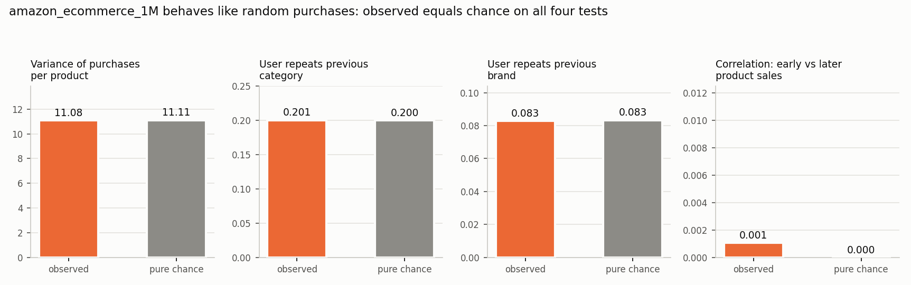
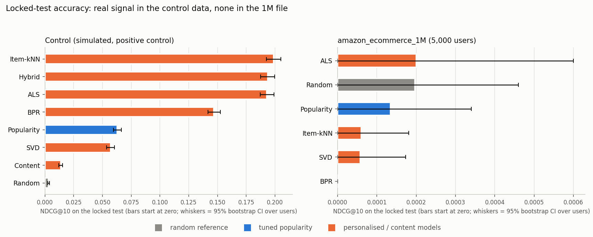
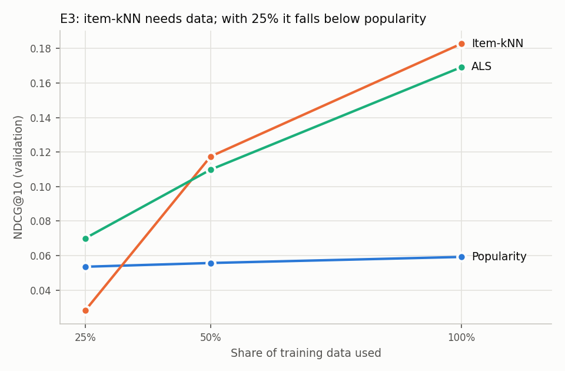
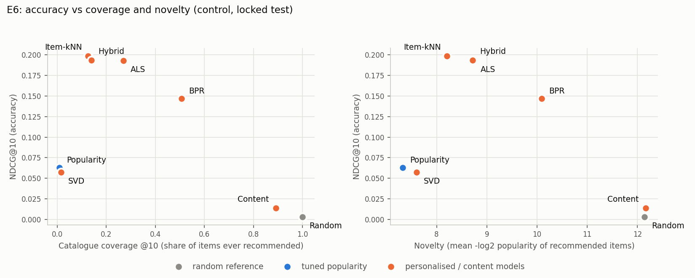

# Final report sections (generated by src/build_report.py from reports/*; every number comes from code that was run)

## V. Results

### A. Data, split and what the data contain

Two purchase-style datasets were used for different jobs and are never merged, because their product ids do not link and the review file has no user ids. **amazon_ecommerce_1M** supplies user-product purchases with dates (Table I). The **Amazon products and reviews** files (728 products, 6,327 reviews, no users) supply real text for the content model. Because the 1M file has a median of one purchase per user, the k-core was set to **k = 2** instead of the planned 5 (only 5,094 of 603,815 users have at least five purchases).

**Table I. Dataset statistics.**

| set | interactions | users | items | sparsity % | avg/user | avg/item | date range |
|---|---|---|---|---|---|---|---|
| full (cleaned) | 999,993 | 603,815 | 89,999 | 99.9982 | 1.66 | 11.11 | 2024-03-31 to 2026-03-31 |
| k-core k=2 | 669,572 | 273,820 | 89,528 | 99.9973 | 2.45 | 7.48 | 2024-03-31 to 2026-03-31 |

Cleaning log: {"raw_rows": 1000000, "after_exact_dup_and_null_drop": 1000000, "after_date_checks": 1000000, "after_user_item_dedup": 999993}

The time-based split (earliest 70% train, next 15% validation, final 15% locked test) is:

| set | rows | share | from | to |
|---|---|---|---|---|
| train | 468,104 | 69.9% | 2024-03-31 | 2025-08-23 |
| validation | 100,429 | 15.0% | 2025-08-24 | 2025-12-11 |
| test (locked) | 101,039 | 15.1% | 2025-12-12 | 2026-03-31 |

Slices (relative to train only):

| set | warm | cold-item | cold-user |
|---|---|---|---|
| validation | 80,325 (80.0%) | 344 (0.3%) | 19,760 (19.7%) |
| test | 80,813 (80.0%) | 409 (0.4%) | 19,817 (19.6%) |

**The 1M file contains no learnable purchase pattern.** Four independent checks (Fig. 1) all match what random purchasing predicts: product popularity has Poisson-like spread, users do not repeat categories or brands more than chance, and a product's early sales do not predict its later sales.

*Fig. 1. Observed statistics in amazon_ecommerce_1M against pure chance.*

To check that the evaluation code can detect signal when it exists, a **positive control** was generated: a simulated dataset with a planted taste structure (5,000 users, 1,986 items, 124,959 purchases), clearly labelled synthetic. All models were run on it with identical code. Results on the control show what the pipeline can find; results on the 1M file show what that real file contains.

### B. Locked-test ranking results (E1, Table III)

Settings were chosen on validation, frozen in `manifests/frozen_settings.json` and committed before any test scoring; final models were refit on train plus validation and every model was scored on the locked test exactly once. Rankings are scored for users with history before the test period (4,912 in the control data; a seeded sample of 5,000 in the 1M file), never recommending an item the user already bought.

**Table III (control data, K = 10).**

| Model                                    |    P@10 |    R@10 |   NDCG@10 |   MAP@10 |   Coverage |   Diversity |   Novelty |
|:-----------------------------------------|--------:|--------:|----------:|---------:|-----------:|------------:|----------:|
| Random (reference)                       | 0.00183 | 0.00424 |   0.00307 |  0.00122 |     1      |     0.98558 |  12.1436  |
| Popularity (tuned)                       | 0.03039 | 0.07994 |   0.06285 |  0.03207 |     0.0095 |     0.97372 |   7.32537 |
| Item-kNN                                 | 0.08673 | 0.23096 |   0.19883 |  0.12157 |     0.126  |     0.95889 |   8.20844 |
| SVD (biased, rating-trained)             | 0.02726 | 0.07278 |   0.05715 |  0.02919 |     0.016  |     0.98315 |   7.6036  |
| ALS                                      | 0.08565 | 0.22627 |   0.19294 |  0.11678 |     0.27   |     0.96576 |   8.73704 |
| BPR                                      | 0.06338 | 0.16962 |   0.14687 |  0.08664 |     0.507  |     0.95248 |  10.0925  |
| Content-based (TF-IDF)                   | 0.00735 | 0.01943 |   0.01369 |  0.00622 |     0.892  |     0.89012 |  12.1633  |
| Hybrid (adaptive: content for new items) | 0.08369 | 0.22283 |   0.19367 |  0.11833 |     0.139  |     0.95468 |   8.7207  |

On the control data the personalised models clearly beat tuned popularity (NDCG@10 0.063): item-kNN reaches 0.199, ALS 0.193, the adaptive hybrid 0.194 and BPR 0.147. The rating-trained SVD (0.057) and the content-only model (0.014) do not.

**Table III (amazon_ecommerce_1M, K = 10).**

| Model                        |   P@10 |   R@10 |   NDCG@10 |   MAP@10 |   Coverage | Diversity          |   Novelty |
|:-----------------------------|-------:|-------:|----------:|---------:|-----------:|:-------------------|----------:|
| Random (reference)           |  6e-05 | 0.0006 |   0.0002  |   8e-05  |    0.42689 | n/a (no item text) |   16.5392 |
| Popularity (tuned)           |  4e-05 | 0.0004 |   0.00013 |   6e-05  |    0.00012 | n/a (no item text) |   15.0663 |
| Item-kNN                     |  2e-05 | 0.0002 |   6e-05   |   2e-05  |    0.37432 | n/a (no item text) |   16.2926 |
| SVD (biased, rating-trained) |  2e-05 | 0.0002 |   6e-05   |   2e-05  |    0.01778 | n/a (no item text) |   16.238  |
| ALS                          |  2e-05 | 0.0002 |   0.0002  |   0.0002 |    0.02495 | n/a (no item text) |   15.3625 |
| BPR                          |  0     | 0      |   0       |   0      |    0.00017 | n/a (no item text) |   16.5903 |

On the 1M file every model scores essentially zero (NDCG@10 between 0.00000 and 0.00020), and random is on par with the rest.

*Fig. 2. Locked-test NDCG@10 with 95% bootstrap intervals over users. Bars start at zero.*

### C. Significance tests

Per-user NDCG@10 differences against tuned popularity were tested with a paired bootstrap (1,000 resamples of users, 95% interval), with a Bonferroni adjustment for the 7 comparisons made on the control data and 5 on the 1M file. A model counts as an improvement only if its interval excludes zero and the adjusted p-value is below 0.05.

**Control data.**

A model counts as an improvement only if its 95% interval excludes zero AND the Bonferroni-adjusted p < 0.05. With 1,000 resamples the smallest reportable p is below 1/1,000.

| Model vs tuned popularity                |   mean NDCG@10 difference |   95% CI low |   95% CI high | p      | p (Bonferroni, x7)   | reading                |
|:-----------------------------------------|--------------------------:|-------------:|--------------:|:-------|:---------------------|:-----------------------|
| Random (reference)                       |                 -0.05978  |    -0.063198 |     -0.056255 | <0.001 | <0.007               | worse than popularity  |
| Item-kNN                                 |                  0.135978 |     0.130655 |      0.14157  | <0.001 | <0.007               | better than popularity |
| SVD (biased, rating-trained)             |                 -0.005698 |    -0.007543 |     -0.003947 | <0.001 | <0.007               | worse than popularity  |
| ALS                                      |                  0.130093 |     0.124279 |      0.136098 | <0.001 | <0.007               | better than popularity |
| BPR                                      |                  0.084026 |     0.078016 |      0.090337 | <0.001 | <0.007               | better than popularity |
| Content-based (TF-IDF)                   |                 -0.049162 |    -0.052885 |     -0.045198 | <0.001 | <0.007               | worse than popularity  |
| Hybrid (adaptive: content for new items) |                  0.130824 |     0.125376 |      0.1363   | <0.001 | <0.007               | better than popularity |

Item-kNN, ALS, BPR and Hybrid are improvements over tuned popularity. SVD and Content are significantly *worse* than it. The adaptive hybrid is 0.005 NDCG@10 below item-kNN on warm users (95% interval [-0.006, -0.004]), the price of reserving slots for new items.

**amazon_ecommerce_1M.**

A model counts as an improvement only if its 95% interval excludes zero AND the Bonferroni-adjusted p < 0.05. With 1,000 resamples the smallest reportable p is below 1/1,000.

| Model vs tuned popularity    |   mean NDCG@10 difference |   95% CI low |   95% CI high |     p |   p (Bonferroni, x5) | reading             |
|:-----------------------------|--------------------------:|-------------:|--------------:|------:|---------------------:|:--------------------|
| Random (reference)           |                  6.2e-05  |    -0.00021  |      0.000389 | 0.726 |                    1 | not distinguishable |
| Item-kNN                     |                 -7.4e-05  |    -0.000211 |      0        | 0.276 |                    1 | not distinguishable |
| SVD (biased, rating-trained) |                 -7.7e-05  |    -0.000287 |      0.000116 | 0.488 |                    1 | not distinguishable |
| ALS                          |                  6.6e-05  |    -0.000269 |      0.0006   | 0.884 |                    1 | not distinguishable |
| BPR                          |                 -0.000134 |    -0.00034  |      0        | 0.276 |                    1 | not distinguishable |

No model is distinguishable from tuned popularity on the 1M file; every interval contains zero. As agreed in advance, we report plainly that popularity is not beaten on this file.

### D. Rating-prediction error (Table IV)

**Table IV (control data, locked test).**

| Model                   |   RMSE |    MAE | RMSE change vs global mean   | Bootstrap 95% CI   |
|:------------------------|-------:|-------:|:-----------------------------|:-------------------|
| Global mean rating      | 0.6728 | 0.6009 | n/a                          | n/a                |
| User/item bias baseline | 0.6334 | 0.5325 | -0.0394                      | [-0.0427, -0.0364] |
| SVD                     | 0.636  | 0.5344 | -0.0368                      | [-0.0404, -0.0333] |

On the control data the user/item bias baseline (RMSE 0.6334) and SVD (RMSE 0.6360) both improve on the global mean (0.6728), but SVD does not improve on the simple bias baseline, and its ranking is worse than popularity. A lower RMSE therefore did not translate into better recommendations, so no RMSE gain is presented as a ranking gain. On the 1M file the same models are slightly *worse* than the global mean (global 0.5208, bias baseline 0.5214, SVD 0.5337): fitting parameters to rating noise hurts.

### E. Experiments E2 to E7

**E2, cold slices.** On the 1M file 8,977 of 101,039 test rows (8.9%) come from users with no earlier history and 146 from unseen items; personalised models cannot score cold users, so popularity is the fallback, and on those users popularity is not distinguishable from random.

Rows by slice relative to the fit data: {'warm': 91916, 'cold-item': 146, 'cold-user': 8977}.

Cold users (no history; 4,370 total, sample of 4,370); personalised models cannot score them and fall back to popularity.

| Model              |   NDCG@10 |   HR@10 |
|:-------------------|----------:|--------:|
| Random             |   0.00021 | 0.00046 |
| Popularity (tuned) |   5e-05   | 0.00023 |

Popularity minus random on cold users: -0.000160, 95% CI [-0.000511, 0.000100], p = 0.360.

The control data has almost no cold rows, so cold items were studied with a stress test on validation: 200 items were hidden from training as "new arrivals". Collaborative filtering recommended none of them (HitRate@10 = 0), while the adaptive hybrid, which scores items with no history by text alone, reached HitRate@10 of 4.2% at content weight 0.1 and 6.5% at 0.3. The cost is that NDCG@10 on ordinary purchases fell from 0.183 to 0.170, because new items occupy list slots.

| w               |   HR@10 |   NDCG@10 |    R@10 |   users |
|:----------------|--------:|----------:|--------:|--------:|
| 0.0             | 0       |   0       | 0       |    1254 |
| 0.1             | 0       |   0       | 0       |    1254 |
| 0.2             | 0       |   0       | 0       |    1254 |
| 0.3             | 0       |   0       | 0       |    1254 |
| 0.5             | 0       |   0       | 0       |    1254 |
| 0.7             | 0.01675 |   0.00485 | 0.01356 |    1254 |
| 1.0             | 0.06778 |   0.02885 | 0.05861 |    1254 |
| adaptive, w=0.0 | 0.0319  |   0.01002 | 0.02671 |    1254 |
| adaptive, w=0.1 | 0.04226 |   0.01358 | 0.03549 |    1254 |
| adaptive, w=0.2 | 0.05582 |   0.01796 | 0.04692 |    1254 |
| adaptive, w=0.3 | 0.06459 |   0.02216 | 0.05449 |    1254 |

### Does the adaptive hybrid hurt ordinary (non-new-item) recommendations?

| model                    |   NDCG@10 on purchases of NON-new items |
|:-------------------------|----------------------------------------:|
| collaborative only (w=0) |                                 0.18915 |
| adaptive hybrid, w=0.1   |                                 0.16995 |

**E3, training size (control, validation only).** Collaborative models degrade quickly with less data; popularity barely moves. With 25% of the training data item-kNN (0.028) falls below popularity (0.054), ALS (0.070) stays above it, and with all data they reach 0.183 and 0.169.

*Fig. 3. NDCG@10 against the share of training data used (control data, validation).*

**E4, hybrid ablation (control, validation).** The validation-best global blend weight is 0, meaning the content signal adds nothing for users with history when item-kNN is available; content alone scores 0.014 on the test. The hybrid's value is confined to new items.

| model                                                            |   NDCG@10 |   HR@10 |   coverage@10 |
|:-----------------------------------------------------------------|----------:|--------:|--------------:|
| tuned popularity                                                 |   0.05919 | 0.25209 |        0.009  |
| content only (w=1)                                               |   0.01295 | 0.06975 |        0.9105 |
| collaborative only (w=0)                                         |   0.18255 | 0.55537 |        0.151  |
| hybrid, global weight w=0.0                                      |   0.18255 | 0.55537 |        0.151  |
| hybrid, adaptive (content-only for items with no history), w=0.0 |   0.17892 | 0.54538 |        0.1595 |

**E5, list length.** NDCG@5 / @10 / @20: Item-kNN > Hybrid > ALS > BPR > Popularity > SVD > Content > Random | Item-kNN > Hybrid > ALS > BPR > Popularity > SVD > Content > Random | Item-kNN > ALS > Hybrid > BPR > Popularity > SVD > Content > Random. The order changes with K.

**E6, accuracy against coverage and novelty.** Content-based and random recommendations cover far more of the catalogue than popularity (coverage 0.009), but accuracy does not rise with coverage: item-kNN and ALS achieve the best accuracy with coverage 0.13 and 0.27, and random reaches full coverage with near-zero accuracy. Diversity (control data only, where item text exists) stays high for every model: the lowest value is 0.89 (content-only), against 0.97 for popularity.

*Fig. 4. Accuracy against catalogue coverage and novelty on the control data (locked test).*

**E7, validation against locked test.** On the control data the model order on the locked test is the same as on validation, so the validation wins survived. On the 1M file the order changed completely, which is what noise looks like and is why intervals, not point estimates, decide the conclusions.

Validation = fit on train, scored on validation (dry run). Test = fit on train + validation, scored on the locked test.

| Model      |   validation NDCG@10 |   locked-test NDCG@10 |   change |   validation HR@10 |   test HR@10 |
|:-----------|---------------------:|----------------------:|---------:|-------------------:|-------------:|
| Random     |              0.00299 |               0.00307 |  7e-05   |            0.01856 |      0.01812 |
| Popularity |              0.05919 |               0.06285 |  0.00366 |            0.25209 |      0.2612  |
| Item-kNN   |              0.18255 |               0.19883 |  0.01628 |            0.55537 |      0.57573 |
| SVD        |              0.05273 |               0.05715 |  0.00442 |            0.21987 |      0.23738 |
| ALS        |              0.16864 |               0.19294 |  0.02431 |            0.53539 |      0.56759 |
| BPR        |              0.13672 |               0.14687 |  0.01015 |            0.45401 |      0.46926 |
| Content    |              0.01295 |               0.01369 |  0.00074 |            0.06975 |      0.07125 |
| Hybrid     |              0.17856 |               0.19367 |  0.01511 |            0.54456 |      0.56637 |

Order on validation: Item-kNN > Hybrid > ALS > BPR > Popularity > SVD > Content > Random

Order on the locked test: Item-kNN > Hybrid > ALS > BPR > Popularity > SVD > Content > Random. The order is unchanged.

### F. Content model on real Amazon text

The product and review files contain no users, so purchases cannot be predicted. As a transparent proxy, TF-IDF similarity was used to find products related to a given product, with "relevant" meaning another product in the same leaf category; category trail and brand were kept out of the model's text. Settings were tuned on half of the 707 evaluable products and reported on the other half. On held-out products, NDCG@10 is **0.567** against 0.038 for random and 0.046 for popularity by rating count. Adding review text helped (title only 0.516, all text 0.567), so reviews carry signal beyond titles and descriptions.

| model                                            |   NDCG@10 |   P@10 |   HR@10 |   MAP@10 |
|:-------------------------------------------------|----------:|-------:|--------:|---------:|
| random                                           |    0.0379 | 0.0367 |  0.2825 |   0.0133 |
| popularity (rating_count)                        |    0.0457 | 0.0393 |  0.2147 |   0.0211 |
| TF-IDF content (max_features=5000, ngram=(1, 2)) |    0.5668 | 0.4794 |  0.9209 |   0.4502 |

## VI. Discussion and Limitations

**What the results say.** Where there is something to learn, the pipeline finds it: on the control data item-kNN scores about 3.2 times tuned popularity and the intervals are far from zero. Where there is nothing to learn, it correctly reports nothing: on the 1M file no model beats tuned popularity, and four independent diagnostics show why (purchases look randomly assigned). The failure to beat popularity on the 1M file is therefore a property of that dataset, not of the methods, and it is the outcome we agreed to report plainly if it occurred.

**Ranking and rating are different tasks.** SVD, trained to predict ratings, improved RMSE on the control data yet ranked below popularity, while ALS and BPR, trained on interactions, ranked far better. The practical lesson is to choose the training objective to match what the page must do.

**Content helps where history is missing.** The content signal was weak for users with history and the validation-best blend gave it zero weight. Its role is cold start: given text alone, the adaptive hybrid surfaced new items that collaborative filtering could not, at a measurable cost to ordinary recommendations. How much that cost is worth paying is a product decision, not a modelling one.

**Data volume matters.** Item-kNN needs co-purchases to learn from and fell below popularity at 25% of the data, so a shop with sparse history should start with popularity or a factor model.

**Limitations.**
1. The only large purchase file is synthetic and carries no signal. The positive control is simulated with a latent-factor structure similar to what matrix-factorisation and neighbourhood models assume, so its absolute numbers favour those models and do not transfer to real shoppers.
2. The real Amazon files have no users or purchases; the content model was validated on a proxy task (same leaf category), not on whether shoppers bought items. The hybrid was therefore demonstrated only on simulated item text.
3. The evaluation is offline. Purchases and reviews are not preferences, and the logged interactions were shaped by what the site showed.
4. The k-core was 2, the 1M file was judged on a seeded sample of 5,000 users, and its grids were reduced to a single factor count because of the machine used. Several best settings on the control data lie at the edge of the planned grids (factors = 32, the smallest value), so larger or finer grids might change them slightly.
5. One seed was used. BPR is multi-threaded and varies by about 0.0002 NDCG@10 between runs. Bonferroni adjustment covers comparisons within a dataset only.
6. Final models were refit on train plus validation with settings frozen from validation; ties in validation were resolved by taking the first setting in grid order.
7. Diversity could be computed only where item text exists. The optional neural collaborative-filtering extension was not run.

## VII. Conclusion

We built a leakage-aware recommender study with a time-based split, frozen settings and a locked test scored once. On a positive-control dataset, neighbourhood and factorisation models trained on interactions beat a tuned popularity baseline with intervals far from zero, a rating-trained SVD did not, and a content-based model gave no gain for users with history but was the only route to recommending brand-new items. On the large Amazon purchase file, popularity was not beaten, and diagnostics show the file behaves like random purchases, so that result reflects the data and not the methods. On real Amazon product text, TF-IDF retrieval recovered related products far above chance. Taken together, the project shows how to evaluate recommenders honestly, including how to recognise when a dataset cannot support any personalised model.
