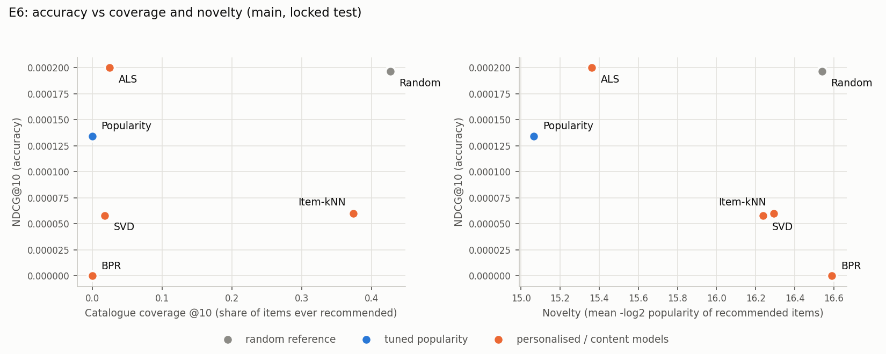

# LOCKED TEST: main (from src/final_eval.py + src/finalize.py)

Settings frozen in manifests/frozen_settings.json. Warm users with history in the fit data: 5,000. Fit data = train + validation; scored on the locked test.

## Table III: ranking results, K = 10 (E1)

| Model                        |   P@10 |   R@10 |   NDCG@10 |   MAP@10 |   Coverage | Diversity          |   Novelty |
|:-----------------------------|-------:|-------:|----------:|---------:|-----------:|:-------------------|----------:|
| Random (reference)           |  6e-05 | 0.0006 |   0.0002  |   8e-05  |    0.42689 | n/a (no item text) |   16.5392 |
| Popularity (tuned)           |  4e-05 | 0.0004 |   0.00013 |   6e-05  |    0.00012 | n/a (no item text) |   15.0663 |
| Item-kNN                     |  2e-05 | 0.0002 |   6e-05   |   2e-05  |    0.37432 | n/a (no item text) |   16.2926 |
| SVD (biased, rating-trained) |  2e-05 | 0.0002 |   6e-05   |   2e-05  |    0.01778 | n/a (no item text) |   16.238  |
| ALS                          |  2e-05 | 0.0002 |   0.0002  |   0.0002 |    0.02495 | n/a (no item text) |   15.3625 |
| BPR                          |  0     | 0      |   0       |   0      |    0.00017 | n/a (no item text) |   16.5903 |

## Paired bootstrap on per-user NDCG@10 (1000 resamples of users; 5 comparisons made; Bonferroni-adjusted)

A model counts as an improvement only if its 95% interval excludes zero AND the Bonferroni-adjusted p < 0.05. With 1,000 resamples the smallest reportable p is below 1/1,000.

| Model vs tuned popularity    |   mean NDCG@10 difference |   95% CI low |   95% CI high |     p |   p (Bonferroni, x5) | reading             |
|:-----------------------------|--------------------------:|-------------:|--------------:|------:|---------------------:|:--------------------|
| Random (reference)           |                  6.2e-05  |    -0.00021  |      0.000389 | 0.726 |                    1 | not distinguishable |
| Item-kNN                     |                 -7.4e-05  |    -0.000211 |      0        | 0.276 |                    1 | not distinguishable |
| SVD (biased, rating-trained) |                 -7.7e-05  |    -0.000287 |      0.000116 | 0.488 |                    1 | not distinguishable |
| ALS                          |                  6.6e-05  |    -0.000269 |      0.0006   | 0.884 |                    1 | not distinguishable |
| BPR                          |                 -0.000134 |    -0.00034  |      0        | 0.276 |                    1 | not distinguishable |

## E5: list-length sweep (K = 5, 10, 20)

| Model      |   NDCG@5 |   NDCG@10 |   NDCG@20 |   HR@5 |   HR@10 |   HR@20 |
|:-----------|---------:|----------:|----------:|-------:|--------:|--------:|
| Random     |   0      |   0.0002  |   0.0003  | 0      |  0.0006 |  0.001  |
| Popularity |   0      |   0.00013 |   0.00013 | 0      |  0.0004 |  0.0004 |
| Item-kNN   |   0      |   6e-05   |   6e-05   | 0      |  0.0002 |  0.0002 |
| SVD        |   0      |   6e-05   |   0.00011 | 0      |  0.0002 |  0.0004 |
| ALS        |   0.0002 |   0.0002  |   0.00025 | 0.0002 |  0.0002 |  0.0004 |
| BPR        |   0      |   0       |   0       | 0      |  0      |  0      |

Model order by NDCG@5 / @10 / @20: ALS > Random > Popularity > Item-kNN > SVD > BPR | ALS > Random > Popularity > Item-kNN > SVD > BPR | Random > ALS > Popularity > SVD > Item-kNN > BPR. The order changes with K.

## Table IV: rating-prediction error on the locked test (101,039 rows)

| Model                   |   RMSE |    MAE | RMSE change vs global mean   | Bootstrap 95% CI   |
|:------------------------|-------:|-------:|:-----------------------------|:-------------------|
| Global mean rating      | 0.5208 | 0.4195 | n/a                          | n/a                |
| User/item bias baseline | 0.5214 | 0.4198 | +0.0006                      | [0.0004, 0.0007]   |
| SVD                     | 0.5337 | 0.4296 | +0.0129                      | [0.0121, 0.0136]   |

## E2: cold slices

Rows by slice relative to the fit data: {'warm': 91916, 'cold-item': 146, 'cold-user': 8977}.

Cold users (no history; 4,370 total, sample of 4,370); personalised models cannot score them and fall back to popularity.

| Model              |   NDCG@10 |   HR@10 |
|:-------------------|----------:|--------:|
| Random             |   0.00021 | 0.00046 |
| Popularity (tuned) |   5e-05   | 0.00023 |

Popularity minus random on cold users: -0.000160, 95% CI [-0.000511, 0.000100], p = 0.360.

## E7: validation vs locked test

Validation = fit on train, scored on validation (dry run). Test = fit on train + validation, scored on the locked test.

| Model      |   validation NDCG@10 |   locked-test NDCG@10 |   change |   validation HR@10 |   test HR@10 |
|:-----------|---------------------:|----------------------:|---------:|-------------------:|-------------:|
| Random     |              0.0002  |               0.0002  | -0       |             0.0004 |       0.0006 |
| Popularity |              0       |               0.00013 |  0.00013 |             0      |       0.0004 |
| Item-kNN   |              0.00013 |               6e-05   | -7e-05   |             0.0002 |       0.0002 |
| SVD        |              0       |               6e-05   |  6e-05   |             0      |       0.0002 |
| ALS        |              0       |               0.0002  |  0.0002  |             0      |       0.0002 |
| BPR        |              0       |               0       |  0       |             0      |       0      |

Order on validation: Random > Item-kNN > Popularity > SVD > ALS > BPR

Order on the locked test: ALS > Random > Popularity > Item-kNN > SVD > BPR. The order changed.

## E6: accuracy vs coverage and novelty

