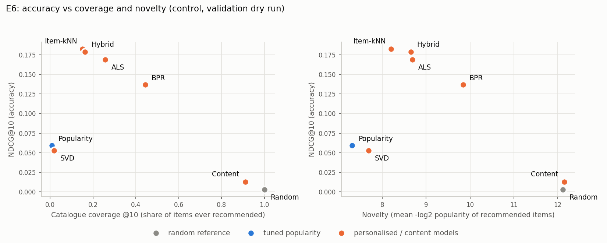

# VALIDATION DRY RUN (fit on train): control (from src/final_eval.py + src/finalize.py)

Settings frozen in manifests/frozen_settings.json. Warm users with history in the fit data: 4,903. Fit data = train; scored on validation.

## Table III: ranking results, K = 10 (E1)

| Model                                    |    P@10 |    R@10 |   NDCG@10 |   MAP@10 |   Coverage |   Diversity |   Novelty |
|:-----------------------------------------|--------:|--------:|----------:|---------:|-----------:|------------:|----------:|
| Random (reference)                       | 0.00188 | 0.00491 |   0.00299 |  0.00113 |     1      |     0.98555 |  12.121   |
| Popularity (tuned)                       | 0.02904 | 0.07677 |   0.05919 |  0.02967 |     0.009  |     0.97205 |   7.30937 |
| Item-kNN                                 | 0.08185 | 0.21848 |   0.18255 |  0.10857 |     0.151  |     0.95875 |   8.20002 |
| SVD (biased, rating-trained)             | 0.02525 | 0.06678 |   0.05273 |  0.02704 |     0.019  |     0.97144 |   7.68478 |
| ALS                                      | 0.07789 | 0.20697 |   0.16864 |  0.09761 |     0.2575 |     0.96591 |   8.68186 |
| BPR                                      | 0.06076 | 0.16375 |   0.13672 |  0.07898 |     0.4435 |     0.9519  |   9.83991 |
| Content-based (TF-IDF)                   | 0.0071  | 0.01845 |   0.01295 |  0.00562 |     0.9105 |     0.89196 |  12.1561  |
| Hybrid (adaptive: content for new items) | 0.07926 | 0.21164 |   0.17856 |  0.10641 |     0.163  |     0.95471 |   8.65043 |

## Paired bootstrap on per-user NDCG@10 (1000 resamples of users; 7 comparisons made; Bonferroni-adjusted)

A model counts as an improvement only if its 95% interval excludes zero AND the Bonferroni-adjusted p < 0.05. With 1,000 resamples the smallest reportable p is below 1/1,000.

| Model vs tuned popularity                |   mean NDCG@10 difference |   95% CI low |   95% CI high | p      | p (Bonferroni, x7)   | reading                |
|:-----------------------------------------|--------------------------:|-------------:|--------------:|:-------|:---------------------|:-----------------------|
| Random (reference)                       |                 -0.056192 |    -0.059864 |     -0.052742 | <0.001 | <0.007               | worse than popularity  |
| Item-kNN                                 |                  0.12336  |     0.117786 |      0.128484 | <0.001 | <0.007               | better than popularity |
| SVD (biased, rating-trained)             |                 -0.006451 |    -0.008598 |     -0.004326 | <0.001 | <0.007               | worse than popularity  |
| ALS                                      |                  0.10945  |     0.103289 |      0.115146 | <0.001 | <0.007               | better than popularity |
| BPR                                      |                  0.077535 |     0.070908 |      0.083559 | <0.001 | <0.007               | better than popularity |
| Content-based (TF-IDF)                   |                 -0.046235 |    -0.050318 |     -0.042648 | <0.001 | <0.007               | worse than popularity  |
| Hybrid (adaptive: content for new items) |                  0.119377 |     0.113921 |      0.124539 | <0.001 | <0.007               | better than popularity |

## E5: list-length sweep (K = 5, 10, 20)

| Model      |   NDCG@5 |   NDCG@10 |   NDCG@20 |    HR@5 |   HR@10 |   HR@20 |
|:-----------|---------:|----------:|----------:|--------:|--------:|--------:|
| Random     |  0.00172 |   0.00299 |   0.00489 | 0.00795 | 0.01856 | 0.03814 |
| Popularity |  0.04781 |   0.05919 |   0.07757 | 0.17112 | 0.25209 | 0.37426 |
| Item-kNN   |  0.15629 |   0.18255 |   0.2151  | 0.4328  | 0.55537 | 0.67061 |
| SVD        |  0.04236 |   0.05273 |   0.06897 | 0.14481 | 0.21987 | 0.33286 |
| ALS        |  0.14106 |   0.16864 |   0.20253 | 0.40445 | 0.53539 | 0.66164 |
| BPR        |  0.11613 |   0.13672 |   0.16302 | 0.33612 | 0.45401 | 0.58046 |
| Content    |  0.00866 |   0.01295 |   0.0203  | 0.03508 | 0.06975 | 0.13645 |
| Hybrid     |  0.15412 |   0.17856 |   0.20897 | 0.42913 | 0.54456 | 0.65552 |

Model order by NDCG@5 / @10 / @20: Item-kNN > Hybrid > ALS > BPR > Popularity > SVD > Content > Random | Item-kNN > Hybrid > ALS > BPR > Popularity > SVD > Content > Random | Item-kNN > Hybrid > ALS > BPR > Popularity > SVD > Content > Random. The order is identical at every K.

## Table IV: rating-prediction error on validation (18,716 rows)

| Model                   |   RMSE |    MAE | RMSE change vs global mean   | Bootstrap 95% CI   |
|:------------------------|-------:|-------:|:-----------------------------|:-------------------|
| Global mean rating      | 0.6663 | 0.5971 | n/a                          | n/a                |
| User/item bias baseline | 0.6259 | 0.5294 | -0.0403                      | [-0.0436, -0.0371] |
| SVD                     | 0.6291 | 0.5312 | -0.0372                      | [-0.0407, -0.0336] |

## E2: cold slices

Rows by slice relative to the fit data: {'warm': 18709, 'cold-item': 7, 'cold-user': 0}.

No cold users in this dataset/split.

## E6: accuracy vs coverage and novelty

