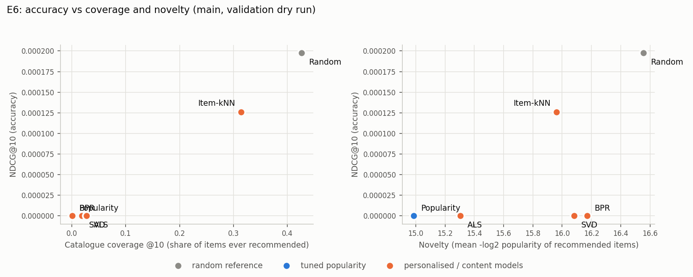

# VALIDATION DRY RUN (fit on train): main (from src/final_eval.py + src/finalize.py)

Settings frozen in manifests/frozen_settings.json. Warm users with history in the fit data: 5,000. Fit data = train; scored on validation.

## Table III: ranking results, K = 10 (E1)

| Model                        |   P@10 |   R@10 |   NDCG@10 |   MAP@10 |   Coverage | Diversity          |   Novelty |
|:-----------------------------|-------:|-------:|----------:|---------:|-----------:|:-------------------|----------:|
| Random (reference)           |  4e-05 | 0.0004 |   0.0002  |  0.00013 |    0.42687 | n/a (no item text) |   16.5553 |
| Popularity (tuned)           |  0     | 0      |   0       |  0       |    0.00012 | n/a (no item text) |   14.9864 |
| Item-kNN                     |  2e-05 | 0.0002 |   0.00013 |  0.0001  |    0.31461 | n/a (no item text) |   15.9621 |
| SVD (biased, rating-trained) |  0     | 0      |   0       |  0       |    0.01853 | n/a (no item text) |   16.082  |
| ALS                          |  0     | 0      |   0       |  0       |    0.0272  | n/a (no item text) |   15.3038 |
| BPR                          |  0     | 0      |   0       |  0       |    0.00021 | n/a (no item text) |   16.1709 |

## Paired bootstrap on per-user NDCG@10 (1000 resamples of users; 5 comparisons made; Bonferroni-adjusted)

A model counts as an improvement only if its 95% interval excludes zero AND the Bonferroni-adjusted p < 0.05. With 1,000 resamples the smallest reportable p is below 1/1,000.

| Model vs tuned popularity    |   mean NDCG@10 difference |   95% CI low |   95% CI high |     p |   p (Bonferroni, x5) | reading             |
|:-----------------------------|--------------------------:|-------------:|--------------:|------:|---------------------:|:--------------------|
| Random (reference)           |                  0.000197 |            0 |      0.000521 | 0.288 |                    1 | not distinguishable |
| Item-kNN                     |                  0.000126 |            0 |      0.000379 | 0.754 |                    1 | not distinguishable |
| SVD (biased, rating-trained) |                  0        |            0 |      0        | 1     |                    1 | not distinguishable |
| ALS                          |                  0        |            0 |      0        | 1     |                    1 | not distinguishable |
| BPR                          |                  0        |            0 |      0        | 1     |                    1 | not distinguishable |

## E5: list-length sweep (K = 5, 10, 20)

| Model      |   NDCG@5 |   NDCG@10 |   NDCG@20 |   HR@5 |   HR@10 |   HR@20 |
|:-----------|---------:|----------:|----------:|-------:|--------:|--------:|
| Random     |  0.00013 |   0.0002  |   0.0002  | 0.0002 |  0.0004 |  0.0004 |
| Popularity |  0       |   0       |   3e-05   | 0      |  0      |  0.0002 |
| Item-kNN   |  0.00013 |   0.00013 |   0.00013 | 0.0002 |  0.0002 |  0.0002 |
| SVD        |  0       |   0       |   0       | 0      |  0      |  0      |
| ALS        |  0       |   0       |   0       | 0      |  0      |  0      |
| BPR        |  0       |   0       |   3e-05   | 0      |  0      |  0.0002 |

Model order by NDCG@5 / @10 / @20: Random > Item-kNN > Popularity > SVD > ALS > BPR | Random > Item-kNN > Popularity > SVD > ALS > BPR | Random > Item-kNN > BPR > Popularity > SVD > ALS. The order changes with K.

## Table IV: rating-prediction error on validation (100,429 rows)

| Model                   |   RMSE |    MAE | RMSE change vs global mean   | Bootstrap 95% CI   |
|:------------------------|-------:|-------:|:-----------------------------|:-------------------|
| Global mean rating      | 0.5187 | 0.4177 | n/a                          | n/a                |
| User/item bias baseline | 0.5193 | 0.4178 | +0.0006                      | [0.0004, 0.0007]   |
| SVD                     | 0.5309 | 0.4268 | +0.0122                      | [0.0115, 0.0129]   |

## E2: cold slices

Rows by slice relative to the fit data: {'warm': 80325, 'cold-item': 344, 'cold-user': 19760}.

Cold users (no history; 14,333 total, sample of 5,000); personalised models cannot score them and fall back to popularity.

| Model              |   NDCG@10 |   HR@10 |
|:-------------------|----------:|--------:|
| Random             |   0.00012 |  0.0002 |
| Popularity (tuned) |   4e-05   |  0.0002 |

Popularity minus random on cold users: -0.000087, 95% CI [-0.000368, 0.000071], p = 0.730.

## E6: accuracy vs coverage and novelty

